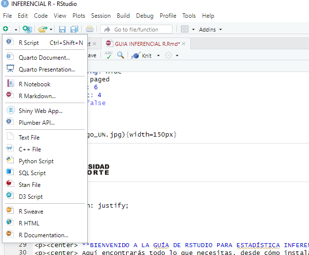
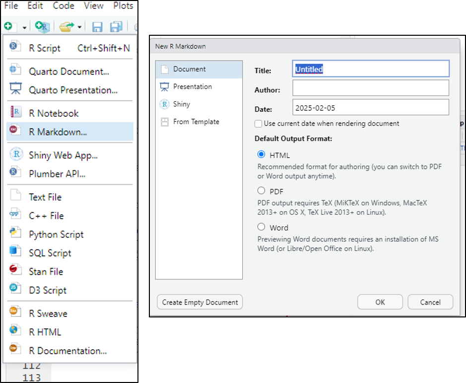
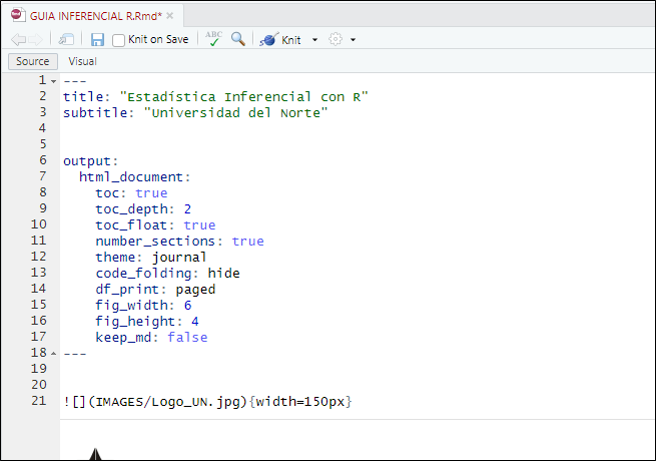
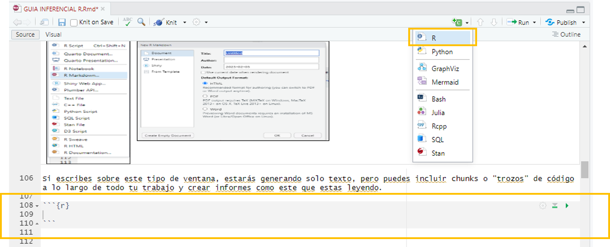
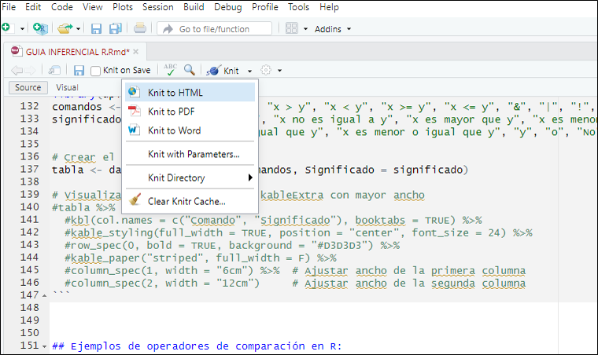
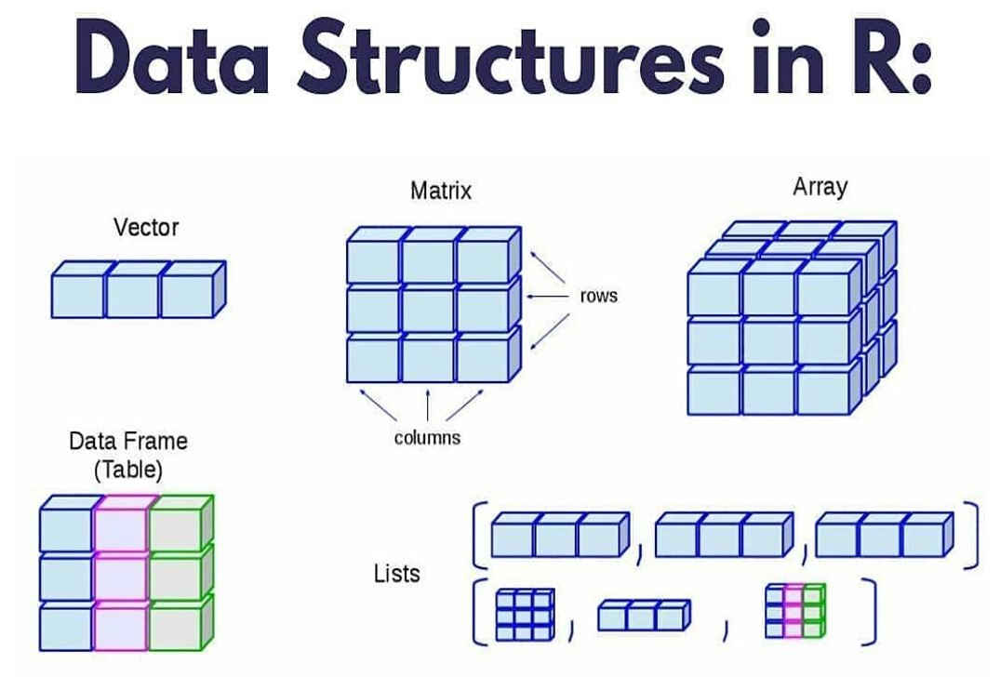
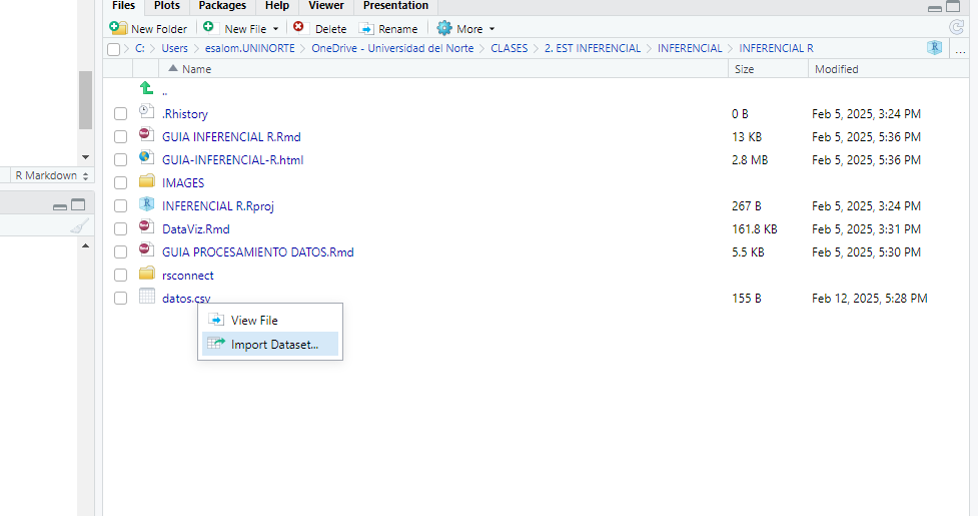

--- 
title: "Análisis Multivariado en Rstudio"
author: "Endy Paola Salon"
site: bookdown::bookdown_site
documentclass: book
bibliography: [book.bib, packages.bib]
# url: your book url like https://bookdown.org/yihui/bookdown
# cover-image: path to the social sharing image like images/cover.jpg
description: |
  Esta es una guía completa, complementaria al curso de Estadística Inferencial ¡Bienvenid@!.
link-citations: yes
github-repo: rstudio/bookdown-demo
---


{width=150px}
<style>
  body {
    text-align: justify;
  }
</style> <br>


<p><center> **BIENVENIDO A LA GUÍA DE RSTUDIO PARA ESTADÍSTICA INFERENCIAL**</center></p>  
<p><center> Aquí encontrarás todo lo que necesitas, desde cómo instalar el programa hasta los primeros pasos</center></p>

# Conoce Rstudio


## Instalación y Configuración de R-STUDIO

### Rstudio en tu equipo (escritorio)

Para comenzar a usar R, el primer paso es instalarlo en tu computadora. R es compatible con casi todas las plataformas, incluyendo los sistemas operativos más comunes. *Windows, Mac OS X y Linux*. [Links de descarga para y RStudio](https://posit.co/download/rstudio-desktop/). **Nota:** Antes de instalar Rstudio, debes instalar R (el motor)

RStudio es un entorno de desarrollo integrado (IDE) disponible para R, el cual tiene un buen editor con resaltado de sintaxis, un visor de objetos de R y un gran número de características agradables que están integradas.Ademas, esta dedicado a la computación estadística y gráficos.

**Otra opción: Rstudio en la nube**

Puedes utilizar Rstudio en cualquier dispositivo conectado a internet y guardar todos tus archivos en la nube. Encontras todo tal como lo dejaste en cualquier equipo. Recuerda que esta versión tiene un límite de horas de uso mensual. [Link de acceso a RStudio Cloud](https://posit.cloud/)


## Primeros pasos

**Rscript**

Puede resultar de mucha utilidad trabajar y guardar los comandos usados en un “script” de R. El script es básicamente un documento de texto donde puedes ir escribiendo todos los comandos a ejecutar, es la hoja de ruta que el programa seguirá para analizar tus datos. Considera el hecho de que si se antepone a una línea de comando el signo #, este no será ejecutado y el programa lo considerará como un comentario.

{width=500} 


**Paquetes o librerías en R**

Las librerías en R son colecciones de funciones, datos y documentación que amplían las capacidades del lenguaje base. También se les llama paquetes (packages). Estas librerías permiten a los usuarios realizar análisis de datos, visualización, modelado estadístico, aprendizaje automático, entre otras tareas, sin necesidad de programar todo desde cero.  

*Ejemplo: “Mundo” Tidyverse en R-Studio*

{width=500} 

El **Tidyverse** es una colección de paquetes del R que permiten preparar, procesar y graficar bases de datos. Se destacan los siguientes:

- **[ggplot](https://ggplot2.tidyverse.org/)**: permite crear visualizaciones elegantes de los datos de una manera relativamente sencilla.
- **[stringr](https://stringr.tidyverse.org/)**: permite manipular cadenas de caracteres con el fin de realizar sustituciones, detectar duplicados, analizar patrones, etc.

- **[tidyr](https://tidyr.tidyverse.org/)**: tiene como objetivo obtener datos ordenados. Destacan funciones como `gather` para crear factores con base en nombres de columnas y `separate` para crear factores separando los caracteres de una columna.

- **[readr](https://readr.tidyverse.org/)**: permite importar y exportar bases de datos en diferentes formatos y tiene implementada la función `problems` que detecta problemas en nuestras bases.

Para más información visitar la página web:  
[https://www.tidyverse.org/packages/](https://www.tidyverse.org/packages/)  

Para instalar librerías: Install.pachages("nombre de la librería") por primera vez y para llamarla o utilizarla library(nombre de la librería) o en su defecto, require(nombre de la librería)


```{r echo=TRUE, warning=FALSE}
# Instalar la librería (solo la primera vez)
#install.packages("tidyverse")

# Cargar la librería
library(tidyverse)

```


### Creación de reportes en R con R Markdown:

{width=500} 

R Markdown es un formato de documento que combina código R, texto y visualizaciones en un solo archivo, permitiendo generar informes dinámicos en varios formatos como HTML, PDF y Word. Es ampliamente utilizado en análisis de datos, reportes automatizados y documentación reproducible.

Se basa en el lenguaje Markdown para formatear el texto y en R para ejecutar código dentro del documento.

*¿Cómo funciona Rmarkdown?*

- En RStudio, ve a File > New File > R Markdown  
- Selecciona el formato de salida (HTML, PDF, Word).  
- Se generará un archivo con extensión .Rmd.  

{width=500}  

**Un archivo .Rmd tiene tres partes principales:**  

- Encabezado YAML: Define el título, autor y formato de salida.
- Texto en Markdown: Usa sintaxis Markdown para formatear el contenido.
- Chunks de código R: Secciones de código R que pueden ejecutarse y mostrar resultados.  

{width=500} 

Si escribes sobre este tipo de ventana, estarás generando solo texto, pero puedes incluir chunks o "trozos" de código a lo largo de todo tu trabajo y crear informes como este que estas leyendo.

{width=500} 


**Renderizar el documento**

- Para generar el documento final, haz clic en "Knit" en RStudio.
- Selecciona el formato de salida (HTML, PDF o Word).
- Se creará un archivo con los resultados y el código ejecutado.


{width=500} 

## Conceptos básicos de programación en R:

Si quieres aprender R, primero necesitas entender cómo funcionan los lenguajes de programación en general

Todos los lenguajes (incluyendo R) tienen ciertas bases comunes:  

- Variables → Almacenan datos.
- Operadores → Realizan cálculos o comparaciones.
- Estructuras de control → Permiten tomar decisiones y repetir tareas.
- Funciones → Agrupan código reutilizable.  

**Creación de Objetos**

R es un lenguaje orientado a objetos. Los objetos pueden ser usados para guardar valores y pueden madificarse mediante funciones como por ejemplo sumar dos objetos o calcular la media.

```{r echo=TRUE}
X <- 4
Y <- 2
```

```{r}
X+Y
```

**R como calculadora**

Puedes hacer operaciones matemáticas básicas como +, -, *, /.  
- También puedes calcular potencias (^), raíces cuadradas (sqrt()), logaritmos (log()) y funciones trigonométricas (sin(), cos(), tan()).
- print() se usa para mostrar los resultados en la consola.

- Prueba este código en RStudio y verás cómo R funciona como una calculadora avanzada.

```{r echo=TRUE, warning=FALSE}

# Operaciones básicas
5 + 3       # Suma
10 - 4     # Resta
6 * 7  # Multiplicación
20 / 5   # División

# Potencias y raíces
2^3     # 2 elevado a la 3
sqrt(16)  # Raíz cuadrada de 16

# Operaciones avanzadas
log(100, base = 10)  # Logaritmo base 10
exp(2)   # e^2
sin(pi / 2)  # Seno de 90 grados (π/2 radianes)

```

### Tipos de variables en R:

| **Tipo**      | **Ejemplo**                           | **Descripción**                   |
|--------------|--------------------------------------|-----------------------------------|
| **Numeric**  | `3.14, -2.5`                         | Números con decimales            |
| **Integer**  | `10L, -5L`                           | Números enteros                  |
| **Character**| `"Hola"`                             | Texto o cadenas de caracteres    |
| **Logical**  | `TRUE, FALSE`                        | Valores lógicos (booleanos)      |
| **Factor**   | `factor("azul", "rojo")`             | Variables categóricas            |
| **Date**     | `as.Date("2024-02-05")`              | Fechas                           |
| **POSIXct**  | `as.POSIXct("2024-02-05 14:30:00")`  | Fechas y horas                   |


```{r, echo=TRUE}
# Numéricas (Numeric)
num <- 3.14  # Número decimal
class(num)

# Enteros (Integer)
entero <- 10L  # Número entero
class(entero)

# Cadenas de Texto (Character)
texto <- "Hola, mundo"
class(texto)

# Lógicos (Logical)
logico <- TRUE
class(logico)

# Factores (Factor)
colores <- factor(c("rojo", "azul", "verde", "rojo"))
class(colores)
levels(colores)  # Ver categorías

# Fechas y Tiempos (Date y POSIXct)
fecha <- as.Date("2024-02-05")  # Convertir a fecha
hora <- as.POSIXct("2024-02-05 14:30:00")  # Fecha y hora
class(fecha)
class(hora)
```

*Nota: La función class permite ver qué tipo de variable estamos utilizando*

### Estructuras de Datos en R:

En R, los datos se pueden organizar en diferentes estructuras según la forma en que se almacena y manipula la información.

| **Estructura** | **Descripción**                                     | **Ejemplo**                        |
|----------------|-----------------------------------------------------|------------------------------------|
| **Vector**     | Secuencia de elementos del mismo tipo               | `c(1, 2, 3, 4, 5)`                |
| **Matrix**     | Tabla bidimensional con el mismo tipo de dato       | `matrix(1:9, nrow = 3, ncol = 3)` |
| **List**       | Contiene diferentes tipos de datos                  | `list(nombre = "Ana", edad = 25)` |
| **Data Frame** | Tabla con columnas de diferentes tipos              | `data.frame(Nombre = c("Ana", "Carlos"), Edad = c(25, 30))` |
| **Factor**     | Variable categórica con niveles                     | `factor(c("rojo", "azul", "verde"))` |
| **Array**      | Estructura multidimensional                         | `array(1:8, dim = c(2,2,2))`     |


*Vectores*

```{r}
# Vector numérico
vector <- c(1, 2, 3, 4, 5)
vector

# Vector de caracteres
caracteres<- c("rojo", "azul", "verde")
caracteres

# Vector lógico
logico <- c(TRUE, FALSE, TRUE)
logico

# Mostrar tipo
class(vector)

```

*Factor*

```{r}
# Crear un factor con categorías
colores <- factor(c("rojo", "azul", "verde", "rojo"))

# Ver niveles
levels(colores)

```

*Matriz*

```{r}
# Crear una matriz 3x3 con números del 1 al 9
matriz <- matrix(1:9, nrow = 3, ncol = 3)
matriz
# Mostrar matriz
print(matriz)

```

*Lista*

Puede contener diferentes tipos de datos (vectores, matrices, data frames, etc.).

```{r}
# Crear una lista con diferentes tipos de datos
mi_lista <- list(nombre = "Ana", edad = 25, notas = c(9, 8, 10))

# Mostrar contenido de la lista
print(mi_lista)

```

*Dataframe*

Es una tabla donde cada columna puede tener diferentes tipos de datos.  
Es la estructura más utilizada en análisis de datos.

```{r}
# Crear un data frame
df <- data.frame(Nombre = c("Ana", "Carlos", "Luis"),  Edad = c(25, 30, 22), Aprobado = c(TRUE, FALSE, TRUE))

# Mostrar data frame
df

```

*Condicional if-else.*

En R, la sintáxis del condicional consiste en:

- **`if (A)`**: evalúa si se cumple la condición A.
- **`else if (B)`**: si no se cumple la condición o condiciones anteriores, entonces evalúe si se cumple la condición B.
- **`else`**: si no se cumple ninguna de las condiciones anteriores entonces haga lo siguiente.

**Ejemplo:**

```{r}
a<-9
 if (a<0){
 print("a es negativo")
 }else if (a>0){
 print("a es positivo")
 }else{
 print("a es igual a cero")
 }
```

*Bucles for:*

Usado para repetir un bloque específico de código, siguiendo una secuencia dada.

```{r}
suma<-0
 for (i in 1:10){
 suma<-suma+i
 }
 suma
```


*Operadores de comparación en R:*

```{r}
# Asignación de valores
a <- 1
b <- 3

# Operaciones y comentarios explicativos

# ¿b es diferente de a?
b != a  # TRUE

# ¿es a igual a b?
isTRUE(a == b)  # FALSE

# Negar que a es menor que b
!(a < b)  # FALSE

# ¿es a menor que b o b menor que a?
(a < b | b < a)  # TRUE

# ¿es a menor o igual a b o b igual a a?
(a <= b & b == a)  # FALSE
```


<!--chapter:end:index.Rmd-->

# Bases de datos en R

Aquí encontraras las herramientas básicas para realizar un análisis exploratorio de Datos en Rstudio.El objetivo es conocer la información, qué primeras impresiones o tendencias mrevelan los datos.

---

## Dataframes (bases de datos)

Un **dataframe** en Rstudio es una estructura de datos similar a una tabla o base de datos, donde las columnas representan variables y las filas representan observaciones.


{width=600px}


### Creación de Dataframes

Es posible crear un dataframe a partir de la unión de vectores con la función `data.frame()`. 

```{r}

#Vectores o listas
nombre = c("Ana", "Luis", "Carlos", "Sofia")
edad = c(23, 25, 30, 22)
ciudad = c("Bogota", "Medellin", "Cali", "Barranquilla")
ingresos = c(2500000, 3000000, 2800000, 2700000)


# Crear un dataframe manualmente
df <- data.frame(nombre,edad,ciudad,ingresos)
  
# Ver el dataframe
df
```

**Acceso a los Datos del dataframe**

Para acceder a las columnas de un dataframe existen varias maneras

```{r}
# Acceder a una columna específica
df$nombre

```

```{r}
# Acceder a una fila específica
df[2, ]

```

```{r}

# Acceder a una celda específica
df[3, 2]
```


**Modificación de Dataframes**

Es posible agregar, modificar o eliminar columnas y filas en un dataframe


Agregar una nueva columna
```{r}
# Agregar una nueva columna

df$puntaje <- c(85, 90, 78, 88)
df

```


Modificar un valor
```{r}
# Modificar un valor

df$ingresos[1] <- 2600000

```

Eliminar una columna
```{r}
# Eliminar una columna

df$ciudad <- NULL
df

```


**Filtrado de Datos**

También, es posible filtrar filas que cumplen ciertas condiciones:

```{r}

# Filtrar personas con ingresos mayores a 2.8 millones
subset(df, ingresos > 2800000)

```

```{r}

# Filtrar personas con puntaje mayor a 80
df[df$puntaje > 80, ]

```


**Ordenamiento de Dataframes**

```{r}

# Ordenar por edad
df_ordenado <- df[order(df$edad), ]
df_ordenado

```

**Guardar Dataframes**

Guardar un dataframe como un archivo CSV (Este es un formato muy común en el que se suelen encontrar las bases de datos):

```{r}
# Guardar dataframe en un archivo CSV

write.csv(df, "datos.csv", row.names = FALSE)
help("write.csv")

```


### Importar un Dataframe desde un archivo CSV

```{r}
# Leer un archivo CSV

df_importado <- read.csv("datos.csv")
df_importado

```

Otra forma para importar datos, es a través de la ventana de archivos

{width=600px}
<style>
  body {
    text-align: justify;
  }
</style> <br>

También es posible importar datos directamente desde donde esté guardada la base de datos en el equipo (cuando se utiliza la versión Rstudio de escritorio) La línea de código sería la siguiente:

```{r eval=FALSE, include=FALSE}
library(readr)
datos <- read_csv("C:/Users/esalom.UNINORTE/Downloads/datos.csv.csv")
datos
```


## Pre procesamiento de una Base de Datos Preinstalada en R

R incluye varias bases de datos preinstaladas. En este ejemplo, usaremos `mtcars`, una base de datos con información sobre automóviles.

```{r}
# Cargar la base de datos mtcars
data("mtcars")
```

```{r}
datos <- mtcars
head(datos)# Ver las primeras filas
```


**Exploración de Datos**

Para ver las dimensiones del dataframe o el tamaño de mi base de datos:

```{r}
# Dimensiones del dataframe
dim(datos)
```

Ver los tipos de datos o variables
```{r}
# Ver estructura de los datos
str(datos)
```
Hacer un resumen estadístico (muy general). Esta es la primera impresión de todas las variables
```{r}
# Resumen estadístico general
summary(datos)
```


**Verificación y Manejo de Datos Faltantes**

Verificar:

```{r}
# Verificar valores faltantes
sum(is.na(datos))
```
Eliminar:
```{r}
# Si hubiera valores NA, podríamos eliminarlos con:
df <- na.omit(datos)
```


::: warning
La solución a los datos faltantes NO SIEMPRE va a ser eliminarlos. Es muy importante dar el tratamiento correcto.
:::


**Eliminación de Columnas Innecesarias**

Si algunas columnas no son relevantes para el análisis, es posible eliminarlas.

```{r}
# Eliminar la columna 'carb'
datos
datos$carb <- NULL
head(datos)
```

**Filtrado de Datos**

Se pueden filtrar observaciones basadas en condiciones específicas.

```{r}
# Filtrar autos con más de 20 millas por galón (mpg)

df_filtrado <- subset(datos, mpg > 20)
df_filtrado
```

**Transformación de Datos**

Podemos agregar columnas nuevas basadas en cálculos.

```{r}
# Crear una nueva columna con consumo en km por litro

datos$km_per_l <- datos$mpg * 0.425144
head(datos)

```

**Cambio de Tipo de Variable**

Podemos convertir una variable numérica en categórica.

```{r}
str(datos)
```


```{r}
# Convertir la variable 'cyl' (cilindros) en factor
datos$cyl <- as.factor(datos$cyl)
```


```{r}
# Ver estructura para confirmar el cambio
str(datos)
```


**Ordenamiento de Datos**

```{r}
# Ordenar por caballos de fuerza (hp)
df_ordenado <- datos[order(datos$hp), ]
head(df_ordenado)
```

<!--chapter:end:01-Dataframes.Rmd-->

# Álgebra: Repaso


En esta lección aprendes a hacer **en R** las operaciones de álgebra que vimos en clase. 

Dos recordatorios de R que vamos a usar todo el tiempo:

- `c( )` crea un vector.
- `matrix( )` crea una matriz. **R llena la matriz por columnas.**


```{r}
# Un vector con tres números
c(5, 2, 7)

# Una matriz 2x2: fíjate cómo se acomodan los números (por columnas)
matrix(c(1, 2, 3, 4), nrow = 2)
```

## Vectores

### Crear vectores

```{r}
u <- c(1, 2)
v <- c(3, 1)
u
v
```

Un vector también puede tener más de dos números (una variable por coordenada):

```{r}
w <- c(4, 0, 2)
length(w)    # cuántas coordenadas tiene
```

### Suma y resta

Se hacen **coordenada por coordenada**:

```{r}
u + v
u - v
```

Gráficamente, la suma es poner un vector a continuación del otro:

```{r}
plot(0, 0, type = "n", xlim = c(-1, 5), ylim = c(-1, 4), xlab = "x", ylab = "y", asp = 1)
grid()
abline(h = 0, v = 0)

arrows(0, 0, u[1], u[2], col = "blue", lwd = 3)                    # u
arrows(0, 0, v[1], v[2], col = "red", lwd = 3)                     # v
arrows(u[1], u[2], u[1] + v[1], u[2] + v[2], col = "red", lty = 2) # v pegado a u
arrows(0, 0, (u + v)[1], (u + v)[2], col = "darkgreen", lwd = 3)   # u + v
```

### Multiplicar por un escalar

Un número multiplica **todas** las coordenadas:

```{r}
2 * u
0.5 * u
-1 * u
```


## Combinaciones lineales

Una **combinación lineal** es multiplicar cada vector por un número y sumar:

$$c_1 \mathbf{v}_1 + c_2 \mathbf{v}_2$$

```{r}
v1 <- c(2, 1)
v2 <- c(1, 2)

# 3 veces v1 más 2 veces v2
3 * v1 + 2 * v2
```

La **base canónica** son los vectores `e1` y `e2`. Las coordenadas de un vector son los coeficientes de su combinación lineal:

```{r}
e1 <- c(1, 0)
e2 <- c(0, 1)

5 * e1 + 4 * e2     # es el vector (5, 4)
```

Dos vectores en la **misma recta** no sirven para llegar a todo el plano:

```{r}
c(1, 2) * 2     # (2, 4) es solo el doble de (1, 2)
```


## Matrices

### Crear una matriz

```{r}
A <- matrix(c(2, 1,
              1, 3), nrow = 2)
A
```

La primera columna es `(2, 1)` y la segunda `(1, 3)`. Para sacar partes de la matriz:

```{r}
A[1, 2]     # fila 1, columna 2
A[, 1]      # primera columna
A[2, ]      # segunda fila
dim(A)      # dimensiones
```

### Suma, resta y escalar

```{r}
B <- matrix(c(1, 0,
              4, 2), nrow = 2)

A + B
A - B
3 * A
```

### Transpuesta

Cambia filas por columnas:

```{r}
t(A)

M <- matrix(c(1, 2, 3, 4, 5, 6), nrow = 2)
M
t(M)
```

### Multiplicar matrices

Se usa `%*%` (no `*`). **El orden importa.**

```{r}
A %*% B
B %*% A
```

Compara con `A * B`, que multiplica casilla por casilla y **no** es el producto de matrices:

```{r}
A * B
```

### Matriz por vector

```{r}
x <- c(3, 2)
A %*% x
```

Es la combinación lineal de las columnas de `A`: 3 veces la columna 1 más 2 veces la columna 2.

```{r}
3 * A[, 1] + 2 * A[, 2]
```

### La matriz identidad

No cambia nada al multiplicar:

```{r}
I <- diag(2)
I

A %*% I
```


## Determinante

El determinante de una matriz 2x2 es `ad - bc`. Mide **cuánto cambia el área**.

```{r}
A <- matrix(c(2, 1,
              1, 3), nrow = 2)

det(A)
2 * 3 - 1 * 1     # a mano: ad - bc
```

Un determinante **cero** significa que la matriz aplasta el plano y no tiene inversa. Pasa cuando una columna es múltiplo de la otra:

```{r}
S <- matrix(c(1, 2,
              2, 4), nrow = 2)
det(S)
```

Para comparar, algunos casos:

```{r}
det(diag(2))                           # identidad: el área no cambia
det(matrix(c(2, 0, 0, 3), nrow = 2))   # estira x2 y x3: el área se multiplica por 6
det(matrix(c(0, 1, 1, 0), nrow = 2))   # intercambia ejes: el signo cambia
```


## Inversa

La inversa `A^{-1}` deshace lo que hace `A`. En R se calcula con `solve()`:

```{r}
A <- matrix(c(2, 1,
              1, 3), nrow = 2)

A_inv <- solve(A)
A_inv
```

Comprobamos que `A` por su inversa da la identidad:

```{r}
A %*% A_inv
```

(Si ves números como `1e-16`, es solo redondeo del computador: cuentan como cero.)

Si el determinante es cero, **no hay inversa**:

```{r, error=TRUE}
S <- matrix(c(1, 2, 2, 4), nrow = 2)
solve(S)
```


## Producto punto y norma

### Producto punto

Se multiplica coordenada por coordenada y se suma:

```{r}
u <- c(2, 1)
v <- c(3, 4)

sum(u * v)           # 2*3 + 1*4
t(u) %*% v           # lo mismo, en forma de matriz
```

### Norma (largo de un vector)

```{r}
sqrt(sum(v * v))     # largo de v = (3, 4)
sqrt(sum(u * u))     # largo de u
```

### Distancia entre dos puntos

Es la norma de la diferencia:

```{r}
sqrt(sum((u - v)^2))
```

### Ángulo entre dos vectores

$$\cos\theta = \frac{u^\top v}{\|u\|\,\|v\|}$$

```{r}
coseno <- sum(u * v) / (sqrt(sum(u * u)) * sqrt(sum(v * v)))
coseno

acos(coseno) * 180 / pi    # el ángulo en grados
```


## Ortogonalidad

Dos vectores son **ortogonales** (perpendiculares) cuando su producto punto es **cero**:

```{r}
p <- c(2, 1)
q <- c(-1, 2)

sum(p * q)
```

Un ejemplo que **no** lo es:

```{r}
sum(p * c(3, 4))
```

Ver el dibujo ayuda:

```{r}
plot(0, 0, type = "n", xlim = c(-3, 3), ylim = c(-2, 3), xlab = "x", ylab = "y", asp = 1)
grid()
abline(h = 0, v = 0)
arrows(0, 0, p[1], p[2], col = "blue", lwd = 3)
arrows(0, 0, q[1], q[2], col = "red", lwd = 3)
```

## Proyección

La proyección de `v` sobre `u` es la "sombra" de `v` en la recta de `u`:

$$\text{proj}_u v = \frac{u^\top v}{u^\top u}\, u$$

```{r}
u <- c(2, 0)
v <- c(3, 4)

c_ <- sum(u * v) / sum(u * u)     # el número por el que se multiplica u
c_

proyeccion <- c_ * u
proyeccion
```

El **residuo** es lo que sobra, y es ortogonal a `u`:

```{r}
residuo <- v - proyeccion
residuo

sum(u * residuo)       # cero: son ortogonales
```

```{r}
plot(0, 0, type = "n", xlim = c(-1, 5), ylim = c(-1, 5), xlab = "x", ylab = "y", asp = 1)
grid()
abline(h = 0, v = 0)
arrows(0, 0, u[1], u[2], col = "blue", lwd = 3)
arrows(0, 0, v[1], v[2], col = "red", lwd = 3)
arrows(0, 0, proyeccion[1], proyeccion[2], col = "darkgreen", lwd = 3)
arrows(proyeccion[1], proyeccion[2], v[1], v[2], col = "purple", lwd = 2)
```
## Valores y vectores propios

Un vector propio `v` de `A` cumple `A v = λ v`: la matriz solo lo **estira** (o encoge), sin girarlo.

```{r}
A <- matrix(c(2, 1,
              1, 2), nrow = 2)

resultado <- eigen(A)
resultado
```

Se guardan por separado así:

```{r}
valores <- resultado$values
vectores <- resultado$vectors

valores        # los valores propios (de mayor a menor)
vectores       # cada columna es un vector propio
```

### Comprobar la definición

```{r}
v1 <- vectores[, 1]

A %*% v1               # lado izquierdo: A por v
valores[1] * v1        # lado derecho: lambda por v
```

Son iguales: `A` solo estiró a `v1` por el factor 3.

(Si en tu computador el vector sale con signo negativo no hay error: un vector y su opuesto marcan la misma recta.)

### Dos atajos útiles

```{r}
sum(valores)       # suma de valores propios = traza
sum(diag(A))

prod(valores)      # producto = determinante
det(A)
```

### Matrices simétricas

Una matriz simétrica cumple `A = t(A)`. Sus vectores propios son **ortogonales**:

```{r}
A == t(A)

sum(vectores[, 1] * vectores[, 2])
```


## Resumen

| Operación | En R |
|:--|:--|
| Vector | `c(1, 2)` |
| Suma, resta, escalar | `u + v`, `u - v`, `2 * u` |
| Combinación lineal | `3 * v1 + 2 * v2` |
| Matriz | `matrix(c(...), nrow = 2)` |
| Transpuesta | `t(A)` |
| Producto de matrices | `A %*% B` |
| Determinante | `det(A)` |
| Inversa / sistema | `solve(A)`, `solve(A, b)` |
| Producto punto | `sum(u * v)` |
| Norma | `sqrt(sum(v * v))` |
| Ortogonales | `sum(u * v) == 0` |
| Proyección | `sum(u * v) / sum(u * u) * u` |
| Valores y vectores propios | `eigen(A)` |


<!--chapter:end:02-Base_algebra.Rmd-->

# Conceptos básicos: Estadística

Antes de hacer análisis multivariado necesitamos tener claro lo básico de **una variable** (univariado) y de **dos variables juntas** (bivariado). 


## Los datos: consumo de combustible de automóviles

Vamos a trabajar con la base **Auto MPG**, un clásico del repositorio de aprendizaje automático de la UCI. Tiene **398 modelos de automóviles** (años 1970 a 1982) con sus características de motor, peso y consumo de combustible. 

### Traer la base desde internet

Con `read.csv()` se puede leer un archivo directamente desde un enlace:

```{r}
# Leer la base desde GitHub
direccion <- "https://raw.githubusercontent.com/mwaskom/seaborn-data/master/mpg.csv"
autos <- read.csv(direccion)
```

Ya está guardada en el objeto `autos`. Los nombres de las columnas vienen en inglés; los cambiamos al español con `names()`:

```{r}
names(autos)     # nombres originales

names(autos) <- c("consumo", "cilindros", "cilindrada", "potencia",
                  "peso", "aceleracion", "anio", "origen", "nombre")
names(autos)     # nombres nuevos
```

| Variable | ¿Qué mide? | Unidad |
|:--|:--|:--|
| `consumo` | Rendimiento de combustible | millas por galón (mpg) |
| `cilindros` | Número de cilindros del motor | 3, 4, 5, 6 u 8 |
| `cilindrada` | Volumen del motor | pulgadas cúbicas |
| `potencia` | Potencia del motor | caballos de fuerza (hp) |
| `peso` | Peso del vehículo | libras |
| `aceleracion` | Tiempo de 0 a 60 mph | segundos |
| `anio` | Año del modelo | 70 = 1970 |
| `origen` | Región de fabricación | usa, europe, japan |
| `nombre` | Marca y modelo | texto |

(Un consumo **mayor** es mejor: el carro recorre más millas con el mismo galón).

## Estructura de la base de datos

En una base de datos, **cada fila es un individuo** (aquí, un modelo de carro) y **cada columna es una variable**.

```{r}
head(autos)       # las primeras 6 filas
```

```{r}
dim(autos)        # filas y columnas
nrow(autos)       # número de individuos (n)
ncol(autos)       # número de variables (p)
```

La función `str()` nos muestra cómo R guardó cada variable:

```{r}
str(autos)
```

Para sacar una variable (una columna) usamos `$`:

```{r}
autos$consumo[1:10]     # consumo de los primeros 10 carros
```

Y para un dato específico, `[fila, columna]`:

```{r}
autos[3, 5]                       # fila 3, columna 5 (peso)
autos[autos$origen == "japan", ][1:3, ]   # los primeros 3 carros japoneses
```

## Tipos de variables

| Tipo | ¿Qué es? | Ejemplo en la base |
|:--|:--|:--|
| Cualitativa nominal | Categorías sin orden | `origen`, `nombre` |
| Cualitativa ordinal | Categorías con orden | (talla: pequeña < mediana < grande) |
| Cuantitativa discreta | Se cuenta | `cilindros`, `anio` |
| Cuantitativa continua | Se mide | `consumo`, `potencia`, `peso`, `aceleracion` |

### Variables cualitativas

Se resumen con **tablas de frecuencias**:

```{r}
table(autos$origen)                          # frecuencias
prop.table(table(autos$origen))              # proporciones
round(100 * prop.table(table(autos$origen)), 1)   # porcentajes
```

```{r}
barplot(table(autos$origen), col = c("steelblue", "orange", "darkgreen"),
        ylab = "Número de modelos", main = "Modelos por región de origen")
```

Dos variables juntas, una **tabla cruzada**:

```{r}
table(autos$cilindros, autos$origen)
```

La mayoría de los carros de Estados Unidos tienen 8 cilindros; los japoneses y europeos, casi todos 4.

Para que R trate una variable como categoría, la convertimos en **factor**:

```{r}
autos$origen <- as.factor(autos$origen)

levels(autos$origen)       # las categorías
summary(autos$origen)
```

### Variables cuantitativas

Se resumen con medidas numéricas. `summary()` da lo esencial de toda la base:

```{r}
summary(autos)
```

## Datos faltantes

En R, un dato faltante se escribe **`NA`**. Primero, ¿cuántos hay en cada variable?

```{r}
colSums(is.na(autos))
```

Solo la `potencia` tiene faltantes: 6 carros. ¿Cuáles son?

```{r}
autos[is.na(autos$potencia), ]
```

### Qué pasa si ignoramos los `NA`

Casi todas las funciones de R devuelven `NA` si hay faltantes:

```{r}
mean(autos$potencia)
```

Hay que decirle que los **ignore** con `na.rm = TRUE`:

```{r}
mean(autos$potencia, na.rm = TRUE)
```

### Eliminar los individuos con faltantes

Para análisis multivariado, lo más sencillo es trabajar con los **casos completos**:

```{r}
autos2 <- na.omit(autos)

nrow(autos)      # antes
nrow(autos2)     # después
```

Perdimos 6 carros (1.5% de la base). Eliminar es simple, pero siempre se debe **mirar cuántos se pierden y por qué**. Si se perdiera, por ejemplo, el 30% de la base, habría que pensar en otra estrategia.

## Valores atípicos (outliers)

Un **outlier** es un dato muy distinto de los demás. El **diagrama de caja** los marca con puntos:

```{r}
boxplot(autos2$potencia, ylab = "Potencia (hp)", col = "lightblue")
```

La regla más usada: un dato es atípico si queda por fuera de

$$[Q_1 - 1.5 \cdot RIC, \;\; Q_3 + 1.5 \cdot RIC]$$

donde $RIC = Q_3 - Q_1$ es el rango intercuartílico. Lo calculamos:

```{r}
q1 <- quantile(autos2$potencia, 0.25)
q3 <- quantile(autos2$potencia, 0.75)
ric <- q3 - q1

limite_inf <- q1 - 1.5 * ric
limite_sup <- q3 + 1.5 * ric

limite_inf
limite_sup
```

¿Qué carros quedan por fuera?

```{r}
atipicos <- autos2[autos2$potencia < limite_inf | autos2$potencia > limite_sup, ]
atipicos[, c("nombre", "potencia", "cilindrada", "consumo")]
```

Son autos americanos grandes, de motor enorme y bajo consumo. **No son errores: son datos reales** y legítimos.

> **Qué hacer con un outlier:** primero revisar si es un error (digitación, unidad). Si es error, se corrige o se quita. Si es un dato real, **no se borra sin pensarlo**: puede ser justo lo más interesante. Lo importante es saber que existe y cuánto afecta.

### Cuánto afectan al resumen

```{r}
sin_atipicos <- autos2$potencia[autos2$potencia >= limite_inf &
                                autos2$potencia <= limite_sup]

# Con los atípicos
mean(autos2$potencia)
median(autos2$potencia)
sd(autos2$potencia)

# Sin los atípicos
mean(sin_atipicos)
median(sin_atipicos)
sd(sin_atipicos)
```

La media y la desviación cambian más que la mediana, que es **robusta**.


## Análisis univariado: una variable

Trabajamos con el consumo de combustible (millas por galón), sin faltantes:

```{r}
consumo <- autos2$consumo
```

### Media

El promedio: suma de los datos dividida entre cuántos son.

$$\bar{x} = \frac{1}{n}\sum_{i=1}^{n} x_i$$

```{r}
sum(consumo) / length(consumo)     # a mano
mean(consumo)                      # con la función
```

### Mediana

El dato del centro cuando se ordenan. La mitad queda por debajo y la mitad por encima.

```{r}
median(consumo)
```

### Varianza

Mide **qué tan dispersos** están los datos alrededor de la media: es el promedio de las desviaciones al cuadrado (dividiendo entre $n-1$).

$$s^2 = \frac{1}{n-1}\sum_{i=1}^{n} (x_i - \bar{x})^2$$

```{r}
# Paso a paso, a mano
desviaciones <- consumo - mean(consumo)
sum(desviaciones^2) / (length(consumo) - 1)

# Con la función
var(consumo)
```

### Desviación estándar

Es la raíz de la varianza. Tiene **las mismas unidades** que los datos (mpg), por eso se interpreta mejor.

```{r}
sqrt(var(consumo))
sd(consumo)
```

### Coeficiente de variación

La desviación estándar como **porcentaje de la media**. Sirve para **comparar la dispersión** de variables con unidades distintas.

$$CV = \frac{s}{\bar{x}} \times 100$$

```{r}
sd(consumo) / mean(consumo) * 100
```

### Todas las variables numéricas a la vez

Con `sapply()` aplicamos una función a varias columnas. Primero separamos las numéricas continuas:

```{r}
numericas <- autos2[, c("consumo", "cilindrada", "potencia", "peso", "aceleracion")]
head(numericas)
```

```{r}
medias <- sapply(numericas, mean)
varianzas <- sapply(numericas, var)
desviaciones <- sapply(numericas, sd)
cv <- desviaciones / medias * 100

resumen <- data.frame(media = medias, varianza = varianzas,
                      desviacion = desviaciones, cv = cv)
round(resumen, 1)
```

Fíjate: la **varianza** del peso es enorme (más de 700000) solo porque está en libras. No se puede comparar con la de la aceleración (unos 7 segundos cuadrados). Pero el **coeficiente de variación** sí es comparable: la cilindrada es la que más varía (cerca del 54%) y la aceleración la que menos (cerca del 18%).

### Gráficos de una variable

```{r}
hist(consumo, col = "lightblue", main = "Consumo de combustible", xlab = "Millas por galón")
abline(v = mean(consumo), col = "red", lwd = 3)
abline(v = median(consumo), col = "darkgreen", lwd = 3)
```

La línea roja es la media y la verde la mediana. Como la media queda a la derecha de la mediana, la distribución tiene una **cola hacia la derecha** (pocos carros de consumo muy alto).

### Comparar por grupos

`tapply()` calcula una medida **para cada categoría**:

```{r}
tapply(autos2$consumo, autos2$origen, mean)
tapply(autos2$consumo, autos2$origen, sd)
```

```{r}
boxplot(consumo ~ origen, data = autos2,
        col = c("steelblue", "orange", "darkgreen"),
        xlab = "Región de origen", ylab = "Consumo (mpg)")
```

Los carros americanos rinden menos por galón que los japoneses y europeos.

## Análisis bivariado: dos variables juntas

Ahora preguntamos: ¿cuando una variable sube, la otra qué hace? Usamos el peso del carro y su consumo.

```{r}
peso <- autos2$peso
consumo <- autos2$consumo
```

### Diagrama de dispersión

Cada punto es **un carro**: su posición dice cuánto pesa y cuánto rinde.

```{r}
plot(peso, consumo, pch = 19, col = "blue",
     xlab = "Peso (libras)", ylab = "Consumo (mpg)")
```

Los carros más pesados **tienden a rendir menos**. Es una relación lineal decreciente.

### Covarianza

Mide si las dos variables **se mueven juntas**.

$$s_{xy} = \frac{1}{n-1}\sum_{i=1}^{n}(x_i - \bar{x})(y_i - \bar{y})$$

- Covarianza **positiva**: cuando una sube, la otra tiende a subir.
- Covarianza **negativa**: cuando una sube, la otra tiende a bajar.
- Covarianza **cercana a cero**: no hay relación lineal.

```{r}
# A mano: se centran los datos y se multiplican
peso_c <- peso - mean(peso)
consumo_c <- consumo - mean(consumo)
sum(peso_c * consumo_c) / (length(peso) - 1)

# Con la función
cov(peso, consumo)
```

Es negativa: se mueven en sentido contrario. Pero **-5517 ¿es mucho o poco?** No lo sabemos, porque depende de las unidades. Veamos qué pasa si pasamos el peso de libras a kilogramos:

```{r}
peso_kg <- peso * 0.4536
cov(peso_kg, consumo)
```

Es otro número, y la relación es **exactamente la misma**. La covarianza **depende de las unidades**, así que no sirve para decir qué tan fuerte es la relación.

### Correlación

La correlación corrige eso: divide la covarianza entre las dos desviaciones estándar.

$$r = \frac{s_{xy}}{s_x \, s_y}$$

```{r}
# A mano
cov(peso, consumo) / (sd(peso) * sd(consumo))

# Con la función
cor(peso, consumo)

# Y con el peso en kilogramos: no cambia
cor(peso_kg, consumo)
```

La correlación **no depende de las unidades** y siempre está entre **-1 y 1**:

| Valor de r | Interpretación |
|:--|:--|
| Cerca de 1 | relación lineal positiva fuerte |
| Cerca de -1 | relación lineal negativa fuerte |
| Cerca de 0 | no hay relación **lineal** |

Aquí $r = -0.83$: una relación lineal negativa **fuerte**.

### Ejemplos para revisar la correlación

```{r, fig.width=9, fig.height=3.5}
par(mfrow = c(1, 3))

plot(peso, consumo, pch = 19, col = "blue",
     main = paste("r =", round(cor(peso, consumo), 2)),
     xlab = "Peso", ylab = "Consumo")

plot(autos2$peso, autos2$potencia, pch = 19, col = "red",
     main = paste("r =", round(cor(autos2$peso, autos2$potencia), 2)),
     xlab = "Peso", ylab = "Potencia")

plot(autos2$aceleracion, autos2$consumo, pch = 19, col = "darkgreen",
     main = paste("r =", round(cor(autos2$aceleracion, autos2$consumo), 2)),
     xlab = "Aceleración (s)", ylab = "Consumo")

par(mfrow = c(1, 1))
```

Izquierda, relación negativa fuerte; en el centro, positiva fuerte (más peso, más potencia); a la derecha, positiva débil.

### Cuidado: correlación no es causalidad

Que dos variables estén correlacionadas **no significa** que una cause la otra. Y la correlación solo mide relaciones **lineales**: puede ser cercana a 0 aunque haya una relación curva fuerte.

## Matriz de correlación

Con muchas variables, calculamos la correlación de **todos los pares** y la organizamos en una **matriz**:

```{r}
R <- cor(numericas)
round(R, 2)
```

Cómo se lee:

- La **diagonal** es siempre 1 (cada variable con ella misma).
- La matriz es **simétrica**: la correlación de A con B es igual a la de B con A.
- Cada casilla es la correlación de la variable de la **fila** con la de la **columna**.

```{r}
R["peso", "consumo"]    # sacar una casilla
```

### Mapa de calor de la matriz de correlación

Una matriz con muchos números cansa la vista. Un **mapa de calor** pinta cada casilla según su correlación: **azul** para positiva, **rojo** para negativa y **blanco** para cercana a cero.

```{r, fig.width=6, fig.height=5}
colores <- colorRampPalette(c("red", "white", "blue"))(21)

par(mar = c(8, 8, 2, 2))    # más margen para los nombres

# La matriz se voltea para que se vea igual que al imprimirla
image(1:5, 1:5, t(R[5:1, ]), col = colores, zlim = c(-1, 1),
      axes = FALSE, xlab = "", ylab = "")
axis(1, at = 1:5, labels = colnames(R), las = 2)
axis(2, at = 1:5, labels = rev(colnames(R)), las = 1)

# Escribir el valor de cada casilla
for (i in 1:5) {
  for (j in 1:5) {
    text(j, 6 - i, round(R[i, j], 2), cex = 0.9)
  }
}

par(mar = c(5, 4, 4, 2) + 0.1)    # volver al margen normal
```

Se ve enseguida el bloque azul de `cilindrada`, `potencia` y `peso` (muy correlacionadas entre sí) y el rojo de `consumo` contra ellas.

También existe el paquete **corrplot**, que lo hace en una sola línea (instálalo una vez con `install.packages("corrplot")`):

```{r, eval=FALSE}
library(corrplot)
corrplot(R, method = "color", addCoef.col = "black")
```

Mira la matriz con atención: `cilindrada`, `potencia` y `peso` están correlacionadas **entre sí con valores de 0.86 a 0.93**. Son variables **muy redundantes**: un motor grande es un motor potente y va en un carro pesado. Más adelante veremos cómo el análisis de componentes principales aprovecha justo esa redundancia.

### Ver todas las relaciones a la vez

`pairs()` hace todos los diagramas de dispersión de una vez:

```{r, fig.width=7, fig.height=7}
pairs(numericas, pch = 19, col = "blue", cex = 0.5)
```

### La matriz de covarianzas

Igual que la de correlaciones, pero con covarianzas. En la **diagonal están las varianzas**:

```{r}
S <- cov(numericas)
round(S, 1)

diag(S)                     # varianzas
varianzas                   # las que calculamos antes
```

Esta matriz (`S`) es la protagonista del análisis multivariado. Fíjate que el peso domina por estar en libras (varianza enorme). Se relaciona con la de correlaciones: la matriz de correlaciones es la matriz de covarianzas de las variables **estandarizadas** (media 0 y desviación 1):

```{r}
estandarizadas <- scale(numericas)
round(cov(estandarizadas), 2)
```

### Cuidado con los grupos mezclados

La relación entre peso y consumo puede ser distinta según el grupo. Coloreemos por región de origen:

```{r}
colores <- c("steelblue", "orange", "darkgreen")[as.numeric(autos2$origen)]

plot(autos2$peso, autos2$consumo, pch = 19, col = colores,
     xlab = "Peso (libras)", ylab = "Consumo (mpg)")
legend("topright", legend = levels(autos2$origen),
       col = c("steelblue", "orange", "darkgreen"), pch = 19)
```

Calculemos la correlación entre peso y consumo **dentro de cada región**:

```{r}
cor(autos2$peso, autos2$consumo)    # todos juntos

usa <- autos2[autos2$origen == "usa", ]
japon <- autos2[autos2$origen == "japan", ]
europa <- autos2[autos2$origen == "europe", ]

cor(usa$peso, usa$consumo)
cor(japon$peso, japon$consumo)
cor(europa$peso, europa$consumo)
```

La relación negativa existe en los tres grupos, pero es **más débil** en japoneses y europeos que en el total. Al mezclar grupos con pesos y consumos muy distintos, la correlación puede **cambiar**. Moraleja: antes de interpretar una correlación, **mira el gráfico** y piensa si hay grupos escondidos.

## Resumen de funciones

| Qué quiero | En R |
|:--|:--|
| Leer datos de internet | `read.csv("enlace")` |
| Cambiar nombres | `names(datos) <- c(...)` |
| Dimensión, estructura | `dim()`, `str()`, `head()` |
| Frecuencias | `table()`, `prop.table()` |
| Faltantes | `is.na()`, `colSums(is.na())`, `na.omit()` |
| Outliers | `boxplot()`, `quantile()` |
| Media, mediana | `mean()`, `median()` |
| Varianza, desviación | `var()`, `sd()` |
| Coeficiente de variación | `sd(x) / mean(x) * 100` |
| Medida por grupos | `tapply(x, grupo, mean)` |
| Dispersión | `plot(x, y)` |
| Covarianza, correlación | `cov(x, y)`, `cor(x, y)` |
| Matrices | `cov(datos)`, `cor(datos)` |
| Todos los gráficos de dispersión | `pairs(datos)` |
| Mapa de calor de correlaciones | `image()` o `corrplot(R)` |
| Estandarizar | `scale(datos)` |


<!--chapter:end:03-Repaso_estadistico.Rmd-->

---
title: "Distribuciones de probabilidad en RStudio"
author: "Endy Paola Salon"
output:
  html_document:
    toc: true
    toc_float: true
    number_sections: true
---

```{r setup, include=FALSE}
knitr::opts_chunk$set(message = FALSE, warning = FALSE, fig.align = "center")
```

# Distribuciones de probabilidad

Esta lección resume las distribuciones necesarias para el curso: la binomial y la normal como modelos de una variable, y la **normal multivariada** como base de las técnicas multivariadas. Los ejemplos provienen de la manufactura.

Las funciones de R para distribuciones siguen siempre el mismo patrón. Para la distribución `norm` existen cuatro:

| Letra | Qué hace | Ejemplo |
|:--|:--|:--|
| `d` | densidad (o probabilidad puntual) | `dnorm()` |
| `p` | probabilidad acumulada, $P(X \le x)$ | `pnorm()` |
| `q` | cuantil (inverso de `p`) | `qnorm()` |
| `r` | números al azar | `rnorm()` |

## Variable aleatoria y distribución binomial

Una **variable aleatoria** $X$ asigna un número a cada resultado de un experimento aleatorio. Es **discreta** si toma valores contables y **continua** si toma cualquier valor de un intervalo. Su **esperanza** $E(X)$ es el valor promedio a largo plazo y su **varianza** $Var(X)$ mide la dispersión.

La **binomial** cuenta los éxitos en $n$ intentos independientes con probabilidad de éxito $p$. Sea una máquina que produce 10 % de piezas defectuosas y 10 piezas inspeccionadas: $X \sim Binomial(10, 0.1)$, con $E(X)=np$ y $Var(X)=np(1-p)$.

```{r}
dbinom(2, size = 10, prob = 0.1)       # P(exactamente 2 defectuosas)
1 - pbinom(2, size = 10, prob = 0.1)   # P(más de 2)

muestra <- rbinom(10000, size = 10, prob = 0.1)
c(mean(muestra), var(muestra))         # cercanos a 1 y 0.9
```

## Distribución normal

La normal tiene forma de campana y queda definida por su media $\mu$ y su desviación estándar $\sigma$: $X \sim N(\mu, \sigma^2)$. Sea el diámetro de una pieza con $\mu = 50$ mm y $\sigma = 0.2$ mm.

```{r}
mu <- 50
sigma <- 0.2

# Piezas dentro de la tolerancia: P(49.7 <= X <= 50.3)
pnorm(50.3, mu, sigma) - pnorm(49.7, mu, sigma)

# Diámetro que deja el 95 % de las piezas por debajo
qnorm(0.95, mu, sigma)
```

La **estandarización** $Z = (X-\mu)/\sigma$ convierte cualquier normal en la normal estándar, de modo que `pnorm(z)` coincide con la probabilidad original:

```{r}
z <- (50.3 - mu) / sigma
c(z, pnorm(z), pnorm(50.3, mu, sigma))
```

Para verificar si unos datos son normales se usa el **gráfico Q-Q**: si los puntos siguen la recta, los datos son compatibles con una normal.

```{r, fig.width=8, fig.height=4}
set.seed(1)
normales <- rnorm(1000, mu, sigma)
sesgados <- rexp(1000, rate = 1/100)    # una distribución no normal

par(mfrow = c(1, 2))
qqnorm(normales, main = "Datos normales");  qqline(normales, col = "red", lwd = 2)
qqnorm(sesgados, main = "Datos sesgados");  qqline(sesgados, col = "red", lwd = 2)
par(mfrow = c(1, 1))
```

## Dos variables: conjunta, marginales y covarianza

Con varias variables se estudia su distribución **conjunta**. Sea $X$ el turno (mañana o tarde) y $Y$ el estado de la pieza:

```{r}
conjunta <- matrix(c(0.45, 0.05,
                     0.40, 0.10), nrow = 2, byrow = TRUE,
                   dimnames = list(c("manana", "tarde"), c("buena", "defectuosa")))

m_turno  <- rowSums(conjunta)      # marginales: suma por filas o columnas
m_estado <- colSums(conjunta)

outer(m_turno, m_estado)           # conjunta si fueran independientes
conjunta                           # conjunta real
```

Las variables son **independientes** si la conjunta es el producto de las marginales; aquí no lo es. La **covarianza** y la **correlación** miden la relación lineal entre dos variables aleatorias:

$$Cov(X, Y) = E[(X - \mu_X)(Y - \mu_Y)] \qquad \rho = \frac{Cov(X, Y)}{\sigma_X \sigma_Y}$$

Independencia implica covarianza cero; el recíproco solo es válido, en general, bajo normalidad multivariada.

## Vector aleatorio y matriz de covarianzas

Un **vector aleatorio** $\mathbf{X} = (X_1, \ldots, X_p)^\top$ queda resumido por su **vector de medias** $\boldsymbol{\mu}$ y su **matriz de covarianzas** $\boldsymbol{\Sigma}$ (varianzas en la diagonal, covarianzas fuera de ella). Sea una máquina con temperatura (°C), vibración (mm/s) y presión (bar):

```{r}
mu <- c(temperatura = 80, vibracion = 5, presion = 4.5)
desv <- c(4, 1, 0.6)

R <- matrix(c(1.0, 0.7, 0.5,
              0.7, 1.0, 0.3,
              0.5, 0.3, 1.0), nrow = 3)

# Covarianza = correlación * sd_i * sd_j
Sigma <- diag(desv) %*% R %*% diag(desv)
dimnames(Sigma) <- list(names(mu), names(mu))
round(Sigma, 2)

eigen(Sigma)$values     # todos positivos: Sigma es válida
```

## Distribución normal multivariada

$\mathbf{X}$ sigue una **normal multivariada**, $\mathbf{X} \sim N_p(\boldsymbol{\mu}, \boldsymbol{\Sigma})$, si su densidad es

$$f(\mathbf{x}) = \frac{1}{(2\pi)^{p/2}\,|\boldsymbol{\Sigma}|^{1/2}} \exp\left\{-\frac{1}{2}(\mathbf{x} - \boldsymbol{\mu})^\top \boldsymbol{\Sigma}^{-1} (\mathbf{x} - \boldsymbol{\mu})\right\}$$

El vector $\boldsymbol{\mu}$ da el **centro** y $\boldsymbol{\Sigma}$ da la **forma**: las curvas de nivel son elipses (elipsoides si $p>2$), con ejes dados por los eigenvectores de $\boldsymbol{\Sigma}$ y largos proporcionales a $\sqrt{\lambda_k}$.

### La densidad y el efecto de la correlación

```{r}
densidad_mv <- function(x, mu, Sigma){
  p <- length(mu)
  resta <- x - mu
  expo <- -0.5 * t(resta) %*% solve(Sigma) %*% resta
  (2 * pi)^(-p / 2) * det(Sigma)^(-0.5) * exp(expo)
}

densidad_mv(c(0, 0), c(0, 0), matrix(c(1, .8, .8, 1), 2))   # densidad en el centro
```

Con `MASS::mvrnorm()` se simulan nubes con las mismas medias y varianzas y tres correlaciones distintas:

```{r, fig.width=9, fig.height=3.5}
library(MASS)
set.seed(10)

par(mfrow = c(1, 3))
for (rho in c(0, 0.8, -0.8)) {
  datos <- mvrnorm(500, mu = c(0, 0), Sigma = matrix(c(1, rho, rho, 1), 2))
  plot(datos, pch = 19, col = "blue", cex = 0.5, xlim = c(-4, 4), ylim = c(-4, 4),
       xlab = "X1", ylab = "X2", main = paste("correlación =", rho))
}
par(mfrow = c(1, 1))
```

Con correlación 0 la nube es circular; con correlación fuerte es una elipse inclinada.

Para dibujar la campana en 3D basta evaluar la densidad en una cuadrícula:

```{r, fig.width=6, fig.height=5}
g <- seq(-3, 3, length.out = 40)
dens <- outer(g, g, Vectorize(function(a, b)
  densidad_mv(c(a, b), c(0, 0), matrix(c(1, .8, .8, 1), 2))))

persp(g, g, dens, theta = 30, phi = 25, col = "lightblue",
      xlab = "X1", ylab = "X2", zlab = "Densidad")
```

### Propiedades

Si $\mathbf{X} \sim N_p(\boldsymbol{\mu}, \boldsymbol{\Sigma})$:

1. Cada variable por separado es normal: $X_i \sim N(\mu_i, \sigma_i^2)$.
2. Toda combinación lineal $\mathbf{a}^\top\mathbf{X}$ es normal, con media $\mathbf{a}^\top\boldsymbol{\mu}$ y varianza $\mathbf{a}^\top \boldsymbol{\Sigma}\, \mathbf{a}$.
3. Covarianza cero implica independencia (solo en la normal).

La propiedad 2 se verifica con la máquina de tres variables y $\mathbf{a} = (1,1,1)$:

```{r}
set.seed(2024)
maquina <- mvrnorm(5000, mu = mu, Sigma = Sigma)
a <- c(1, 1, 1)

c(teoria = drop(t(a) %*% Sigma %*% a), simulacion = var(maquina %*% a))
```

## Distancia de Mahalanobis y normalidad multivariada

La **distancia de Mahalanobis** al cuadrado mide qué tan lejos está un punto del centro teniendo en cuenta varianzas y correlaciones. Es el exponente de la densidad normal:

$$d^2 = (\mathbf{x} - \boldsymbol{\mu})^\top \boldsymbol{\Sigma}^{-1} (\mathbf{x} - \boldsymbol{\mu})$$

```{r}
punto <- c(88, 4, 5)
mahalanobis(punto, center = mu, cov = Sigma)
```

Si los datos son normales multivariados con $p$ variables, $d^2$ sigue una distribución **chi-cuadrado** con $p$ grados de libertad. Esto sirve para detectar atípicos y para un gráfico equivalente al Q-Q:

```{r}
d2 <- mahalanobis(maquina, center = mu, cov = Sigma)

mean(d2 > qchisq(0.99, df = 3))     # cerca de 1 %

plot(qchisq(ppoints(length(d2)), df = 3), sort(d2), pch = 19, col = "blue", cex = 0.5,
     xlab = "Cuantiles chi-cuadrado (3 gl)", ylab = "d² de Mahalanobis")
abline(0, 1, col = "red", lwd = 2)
```

Los puntos siguen la recta porque los datos fueron simulados con una normal multivariada.

### Con datos reales

El mismo diagnóstico se aplica a datos reales (base de autos; requiere conexión a internet):

```{r}
autos <- na.omit(read.csv("https://raw.githubusercontent.com/mwaskom/seaborn-data/master/mpg.csv"))
datos <- autos[, c("mpg", "horsepower", "weight")]

d2 <- mahalanobis(datos, colMeans(datos), cov(datos))
plot(qchisq(ppoints(nrow(datos)), df = 3), sort(d2), pch = 19, col = "blue", cex = 0.5,
     xlab = "Cuantiles chi-cuadrado (3 gl)", ylab = "d² de Mahalanobis")
abline(0, 1, col = "red", lwd = 2)
```

Los puntos se separan de la recta en la parte alta: hay autos más extremos de lo que permitiría una normal. La normalidad multivariada es un supuesto que debe revisarse, y los datos reales rara vez la cumplen exactamente.

## Resumen de funciones

| Qué se necesita | En R |
|:--|:--|
| Binomial | `dbinom()`, `pbinom()`, `rbinom()` |
| Normal | `dnorm()`, `pnorm()`, `qnorm()`, `rnorm()` |
| Marginales de una tabla | `rowSums()`, `colSums()` |
| Simular normal multivariada | `MASS::mvrnorm(n, mu, Sigma)` |
| Distancia de Mahalanobis | `mahalanobis(x, center, cov)` |
| Cuantil chi-cuadrado | `qchisq()` |
| Gráfico Q-Q | `qqnorm()`, `qqline()` |


<!--chapter:end:04-Distribuciones.Rmd-->

# Análisis de componentes principales

El **análisis de componentes principales (PCA)** resume un conjunto de variables correlacionadas en pocas variables nuevas, los **componentes principales**. Cada componente es una combinación lineal de las variables originales, los componentes no están correlacionados entre sí y están ordenados de mayor a menor varianza.

El capítulo tiene dos partes. En la primera, un ejemplo pequeño se resuelve **paso a paso con operaciones de matrices**, para ver qué hay detrás de la técnica. En la segunda, un conjunto de datos reales se analiza **de forma completa con funciones automáticas**: exploración, verificación de supuestos, cálculo, selección de componentes, interpretación y gráficos.

### Notación

Sea $\mathbf{X}=(X_1,\dots,X_p)^\top$ un vector aleatorio con media $\boldsymbol{\mu}$ y matriz de covarianzas $\Sigma$. Con datos, estas cantidades se estiman por $\bar{\mathbf{x}}$ y $S$ (o por la matriz de correlaciones $R$). 

| Símbolo | Significado |
|:--|:--|
| $\lambda_1\ge\cdots\ge\lambda_p$ | eigenvalores de $S$ (o de $R$): varianzas de los componentes |
| $\mathbf{v}_1,\dots,\mathbf{v}_p$ | eigenvectores unitarios: **loadings** (direcciones de los ejes) |
| $Z_k=\mathbf{v}_k^\top(\mathbf{X}-\boldsymbol{\mu})$ | $k$-ésimo componente principal |
| $z_{ik}$ | **score** de la observación $i$ en el componente $k$ |
| $\lambda_k/\sum_j\lambda_j$ | proporción de varianza explicada (PVE) |

Resultado central: $\operatorname{Var}(Z_k)=\lambda_k$, $\operatorname{Cov}(Z_j,Z_k)=0$ para $j\neq k$ y $\sum_k\lambda_k=\operatorname{tr}(S)$. El procedimiento sigue siempre cinco pasos:

| Paso | Operación | Función en R |
|:--|:--|:--|
| 1 | Centrar y, si hace falta, estandarizar | `scale()` |
| 2 | Calcular la matriz de covarianzas o de correlaciones | `cov()`, `cor()` |
| 3 | Obtener eigenvalores y eigenvectores | `eigen()` |
| 4 | Seleccionar el número de componentes | PVE, gráfico de sedimentación |
| 5 | Proyectar los datos (scores) e interpretar | `%*%`, `prcomp()` |

## Parte A. Ejemplo manual

### Datos

Una máquina registra temperatura (°C), vibración (mm/s) y presión (bar) en ocho momentos. Es un conjunto pequeño, suficiente para seguir cada operación.

```{r}
maq <- data.frame(
  temperatura = c(78.8, 73.6, 72.0, 74.4, 74.0, 66.2, 73.1, 72.6),
  vibracion   = c(4.6, 3.4, 2.7, 3.6, 3.7, 2.5, 3.0, 3.4),
  presion     = c(4.7, 4.9, 5.4, 4.8, 4.8, 5.4, 5.7, 5.9))

X <- as.matrix(maq)
n <- nrow(X)      # observaciones
p <- ncol(X)      # variables
X
```

```{r}
pairs(maq, pch = 19, col = "steelblue")
```

Temperatura y vibración crecen juntas; la presión se mueve en sentido contrario. Hay información repetida entre las variables.

### Paso 1. Centrado y estandarización

Centrar significa restar a cada variable su media; estandarizar, además, dividir entre su desviación estándar. Las varianzas originales muestran por qué conviene estandarizar:

```{r}
medias <- colMeans(X)
round(medias, 2)
round(apply(X, 2, var), 2)   # la temperatura domina solo por sus unidades
```

```{r}
Xc <- sweep(X, 2, medias)                  # datos centrados
Z  <- scale(X)                             # datos estandarizados

round(colMeans(Xc), 10)                    # medias cero
round(apply(Z, 2, sd), 10)                 # desviaciones uno
```

### Paso 2. Matrices de covarianzas y de correlaciones

La matriz de covarianzas es $S=\frac{1}{n-1}X_c^\top X_c$. Con datos estandarizados, la misma operación produce la matriz de correlaciones $R$.

```{r}
S <- t(Xc) %*% Xc / (n - 1)
round(S, 2)
all.equal(S, cov(X), check.attributes = FALSE)
```

```{r}
R <- t(Z) %*% Z / (n - 1)
round(R, 2)
all.equal(R, cor(X), check.attributes = FALSE)
```

Se trabaja con $R$, porque las unidades de las variables no son comparables.

### Paso 3. Eigenvalores y eigenvectores

Los eigenvalores $\lambda_k$ y eigenvectores $\mathbf{v}_k$ de $R$ cumplen $R\mathbf{v}_k=\lambda_k\mathbf{v}_k$. La función `eigen()` los devuelve ordenados de mayor a menor.

```{r}
e <- eigen(R)
valores  <- e$values
vectores <- e$vectors
rownames(vectores) <- colnames(X)
colnames(vectores) <- paste0("PC", 1:p)

round(valores, 3)
round(vectores, 3)
```

Verificación de la definición para el primer par:

```{r}
R %*% vectores[, 1]          # lado izquierdo
valores[1] * vectores[, 1]   # lado derecho
```

Los eigenvectores son unitarios y perpendiculares entre sí:

```{r}
round(t(vectores) %*% vectores, 10)    # matriz identidad
```

El signo de cada eigenvector es arbitrario: $\mathbf{v}$ y $-\mathbf{v}$ definen el mismo eje.

### Paso 4. Varianza explicada

La proporción de varianza explicada por el componente $k$ es $\lambda_k/\sum_j\lambda_j$. Con una matriz de correlaciones, la suma de los eigenvalores es $p$.

```{r}
sum(valores)                            # igual a p = 3

pve <- valores / sum(valores)
round(rbind(PVE = pve, Acumulada = cumsum(pve)), 3)
```

```{r}
plot(valores, type = "b", pch = 19, xlab = "Componente", ylab = "Eigenvalor",
     main = "Gráfico de sedimentación")
abline(h = 1, lty = 2, col = "red")    # criterio de Kaiser
```

El primer componente explica cerca de 79 % de la variabilidad; con dos se alcanza 97 %. Un tercer componente aporta poco.

### Paso 5. Scores

Los scores son las coordenadas de las observaciones en los nuevos ejes: $Z_{\text{scores}}=Z\,V$.

```{r}
scores <- Z %*% vectores
round(scores, 2)
```

Las propiedades del teorema se verifican directamente: los componentes tienen varianza $\lambda_k$ y covarianza cero.

```{r}
round(cov(scores), 3)     # diagonal: eigenvalores; fuera de la diagonal: ceros
round(valores, 3)
```

```{r}
plot(scores[, 1], scores[, 2], pch = 19, col = "steelblue",
     xlab = "PC1", ylab = "PC2", main = "Scores")
text(scores[, 1], scores[, 2], labels = 1:n, pos = 3)
abline(h = 0, v = 0, col = "grey80")
```

### Loadings y correlación con las variables

Los loadings indican el peso de cada variable en el componente. Cuando se parte de $R$, la correlación entre la variable $j$ y el componente $k$ es $\sqrt{\lambda_k}\,v_{jk}$.

```{r}
round(vectores[, 1:2], 2)

correl <- sweep(vectores, 2, sqrt(valores), "*")
round(correl[, 1:2], 2)

round(cor(Z, scores)[, 1:2], 2)     # coincide con la tabla anterior
```

El primer componente tiene cargas del mismo signo en temperatura y vibración, y signo contrario en presión: describe un régimen de operación con calor y vibración altos y presión baja.


### Comprobación con `prcomp()`

La función `prcomp()` realiza todos los pasos anteriores:

```{r}
pc <- prcomp(X, scale. = TRUE)

all.equal(pc$sdev^2, valores)
all.equal(abs(unname(pc$rotation)), abs(unname(vectores)))
all.equal(abs(unname(pc$x)), abs(unname(scores)))
```

Los resultados son iguales salvo el signo de las columnas. Con los fundamentos claros, la segunda parte usa funciones automáticas.

## Parte B. Aplicación con datos reales

### Datos

El conjunto de datos **Wine** (Forina et al., UCI Machine Learning Repository) contiene el análisis químico de 178 vinos italianos producidos por tres cultivares. Cada vino tiene 13 mediciones. El cultivar se usará solo para validar el resultado, no para calcular los componentes.

```{r}
url <- "https://raw.githubusercontent.com/jbrownlee/Datasets/master/wine.csv"
vino <- read.csv(url, header = FALSE)

names(vino) <- c("Alcohol", "Malico", "Ceniza", "Alcalinidad", "Magnesio",
                 "Fenoles", "Flavonoides", "NoFlavonoides", "Proantocianinas",
                 "Color", "Matiz", "OD280", "Prolina", "Cultivar")
vino$Cultivar <- factor(vino$Cultivar)

str(vino)
```

| Variable | Descripción |
|:--|:--|
| `Alcohol`, `Malico`, `Ceniza`, `Alcalinidad`, `Magnesio` | contenido de alcohol, ácido málico, ceniza, alcalinidad de la ceniza y magnesio |
| `Fenoles`, `Flavonoides`, `NoFlavonoides`, `Proantocianinas` | compuestos fenólicos |
| `Color`, `Matiz` | intensidad y tono del color |
| `OD280` | absorbancia de los vinos diluidos |
| `Prolina` | contenido de prolina |

```{r}
X <- vino[, 1:13]          # variables cuantitativas para PCA
n <- nrow(X)
p <- ncol(X)

c(n = n, p = p)
sum(is.na(X))              # datos faltantes
table(vino$Cultivar)
```

### Exploración univariada

```{r}
summary(X)
```

```{r, fig.width=9, fig.height=6}
par(mfrow = c(3, 5))
for (v in names(X)) hist(X[[v]], main = v, xlab = "", col = "lightblue")
par(mfrow = c(1, 1))
```

La mayoría de las variables tiene forma aproximadamente simétrica; `Malico` y `Proantocianinas` muestran cola derecha. Las escalas son muy distintas:

```{r}
round(sapply(X, sd), 2)
```

La desviación de `Prolina` (cercana a 315) es mayor que la de cualquier otra variable. Sin estandarizar, `Prolina` dominaría el primer componente. Por ello el análisis se hará con la **matriz de correlaciones**.

### Exploración bivariada

```{r, fig.width=7, fig.height=7}
library(corrplot)

R <- cor(X)
corrplot(R, method = "color", type = "upper", tl.col = "black", tl.cex = 0.8,
         addCoef.col = "black", number.cex = 0.5)
```

Un grupo de variables fenólicas (`Fenoles`, `Flavonoides`, `OD280`, `Proantocianinas`) muestra correlaciones moderadas a altas, lo que indica redundancia aprovechable por PCA.

```{r}
# Pares con correlación mayor a 0.6 en valor absoluto
pares <- which(abs(R) > 0.6 & upper.tri(R), arr.ind = TRUE)
data.frame(var1 = rownames(R)[pares[, 1]], var2 = colnames(R)[pares[, 2]],
           r = round(R[pares], 2))
```

```{r, fig.width=7, fig.height=7}
pairs(X[, c("Alcohol", "Flavonoides", "Color", "Prolina")],
      pch = 19, col = vino$Cultivar, cex = 0.6)
```

Las relaciones son aproximadamente lineales, y los colores (cultivares) ya se separan en algunos pares.

### Verificación de supuestos

PCA requiere variables cuantitativas, relaciones aproximadamente lineales, correlaciones suficientes, tamaño de muestra adecuado y ausencia de atípicos extremos. La normalidad multivariada no es necesaria para el cálculo descriptivo, pero se revisa porque facilita la inferencia.

#### Correlación suficiente

Si $R$ fuera la identidad, no habría estructura que resumir. Una señal es el determinante de $R$, que se acerca a 0 con variables redundantes:

```{r}
det(R)
```

La **prueba de esfericidad de Bartlett** contrasta $H_0: R = I$ con el estadístico

$$\chi^2 = -\left(n-1-\frac{2p+5}{6}\right)\ln|R|, \qquad gl = \frac{p(p-1)}{2}.$$

```{r}
chi2 <- -(n - 1 - (2 * p + 5) / 6) * log(det(R))
gl <- p * (p - 1) / 2

c(chi2 = chi2, gl = gl, valor_p = pchisq(chi2, gl, lower.tail = FALSE))
```

El valor $p$ es prácticamente cero: se rechaza $H_0$ y hay correlación suficiente. Con el paquete `psych` se obtiene lo mismo:

```{r}
library(psych)
cortest.bartlett(R, n = n)
```

#### Adecuación muestral: índice KMO

El índice de **Kaiser-Meyer-Olkin** compara las correlaciones con las correlaciones parciales. Valores sobre 0.6 se consideran aceptables y sobre 0.8, buenos.

```{r}
kmo <- KMO(R)
round(kmo$MSA, 3)            # KMO global
round(kmo$MSAi, 2)           # KMO por variable
```

El KMO global es 0.78, aceptable. Todas las variables superan 0.6 salvo `Ceniza` (0.44), que aporta menos estructura común. Se conserva en el análisis, pero se interpreta con cautela.

#### Tamaño muestral

Una regla práctica pide al menos 5 a 10 observaciones por variable. Aquí hay $178/13\approx 13.7$, suficiente.

#### Atípicos multivariados

La distancia de Mahalanobis al cuadrado, $d^2=(\mathbf{x}-\bar{\mathbf{x}})^\top S^{-1}(\mathbf{x}-\bar{\mathbf{x}})$, se compara con el cuantil 0.99 de una chi-cuadrado con $p$ grados de libertad.

```{r}
d2 <- mahalanobis(X, colMeans(X), cov(X))
corte <- qchisq(0.99, df = p)

corte
which(d2 > corte)           # observaciones señaladas
round(sort(d2, decreasing = TRUE)[1:6], 1)
```

```{r}
plot(d2, pch = 19, col = ifelse(d2 > corte, "red", "steelblue"),
     xlab = "Observación", ylab = "d² de Mahalanobis")
abline(h = corte, lty = 2)
```

Seis vinos superan el corte (3.4 % de la muestra). Con una normal se esperaría cerca de 1 %. Se mantienen en el análisis, pero se vigilarán en los resultados; la observación 111 es la más extrema.

#### Normalidad multivariada

```{r}
plot(qchisq(ppoints(n), df = p), sort(d2), pch = 19, col = "steelblue", cex = 0.6,
     xlab = "Cuantiles chi-cuadrado", ylab = "d² de Mahalanobis")
abline(0, 1, col = "red", lwd = 2)
```

Los puntos siguen la recta salvo en la cola superior, que corresponde a los atípicos ya identificados. La aproximación es razonable para un análisis descriptivo.

### Cálculo de componentes

```{r}
pca <- prcomp(X, scale. = TRUE)
summary(pca)
```

El objeto `pca` contiene `sdev` (desviaciones de los componentes), `rotation` (loadings) y `x` (scores).

```{r}
eigenvalores <- pca$sdev^2
round(eigenvalores, 2)
sum(eigenvalores)            # igual a p = 13
```

### Selección del número de componentes

```{r}
pve <- eigenvalores / sum(eigenvalores)
tabla <- data.frame(Componente = paste0("PC", 1:p),
                    Eigenvalor = round(eigenvalores, 2),
                    PVE = round(100 * pve, 1),
                    Acumulada = round(100 * cumsum(pve), 1))
tabla
```

```{r, fig.width=9, fig.height=4}
library(factoextra)

fviz_eig(pca, addlabels = TRUE, ncp = 13, main = "Gráfico de sedimentación")
```

```{r}
plot(cumsum(pve), type = "b", pch = 19, ylim = c(0, 1),
     xlab = "Componentes retenidos", ylab = "Varianza acumulada")
abline(h = c(0.7, 0.8), lty = 2, col = "red")
```

Criterios de decisión:

| Criterio | Resultado |
|:--|:--|
| Kaiser ($\lambda>1$) | 3 componentes (4.71, 2.50, 1.45) |
| Varianza acumulada | 66.5 % con 3; 80.2 % con 5 |
| Codo del gráfico | cambio de pendiente después del tercer componente |

Se retienen **tres componentes**, que explican 66.5 % de la varianza. Para visualizar se usan los dos primeros (55.4 %).

### Interpretación de loadings

```{r}
cargas <- pca$rotation[, 1:3]
round(cargas, 2)
```

```{r, fig.width=9, fig.height=4}
par(mfrow = c(1, 3))
for (k in 1:3) {
  barplot(cargas[, k], las = 2, col = ifelse(cargas[, k] > 0, "steelblue", "firebrick"),
          main = paste0("PC", k), cex.names = 0.7)
  abline(h = 0)
}
par(mfrow = c(1, 1))
```

La correlación de cada variable con los componentes es $\sqrt{\lambda_k}\,v_{jk}$:

```{r}
correl <- sweep(pca$rotation, 2, pca$sdev, "*")
round(correl[, 1:3], 2)
```

```{r, fig.width=7, fig.height=6}
fviz_pca_var(pca, col.var = "cos2", gradient.cols = c("black", "orange", "green"),
             repel = TRUE)
```

Interpretación sugerida (los signos son arbitrarios; importan los contrastes):

- **PC1** contrasta `Flavonoides`, `Fenoles`, `OD280`, `Proantocianinas` y `Matiz` (peso negativo) frente a `NoFlavonoides`, `Alcalinidad` y `Malico` (peso positivo): un eje de **contenido fenólico**.
- **PC2** está dominado por `Color`, `Alcohol`, `Prolina` y `Magnesio`: un eje de **intensidad** del vino (color, alcohol, prolina).
- **PC3** se asocia sobre todo con `Ceniza` y `Alcalinidad`.

El aporte de cada variable a los dos primeros ejes se resume en un gráfico de contribuciones:

```{r, fig.width=8, fig.height=4}
fviz_contrib(pca, choice = "var", axes = 1:2, top = 13)
```

### Scores y gráficos de observaciones

```{r}
scores <- pca$x
round(head(scores[, 1:3]), 2)
```

```{r, fig.width=7, fig.height=6}
plot(scores[, 1], scores[, 2], pch = 19, col = vino$Cultivar,
     xlab = paste0("PC1 (", round(100 * pve[1], 1), " %)"),
     ylab = paste0("PC2 (", round(100 * pve[2], 1), " %)"),
     main = "Scores: vinos según cultivar")
abline(h = 0, v = 0, col = "grey80")
legend("topright", legend = levels(vino$Cultivar), col = 1:3, pch = 19, title = "Cultivar")
```

Los tres cultivares se separan en el plano de los dos primeros componentes, aunque PCA no usó esa información.

```{r, fig.width=8, fig.height=6}
fviz_pca_ind(pca, geom = "point", col.ind = vino$Cultivar,
             addEllipses = TRUE, legend.title = "Cultivar")
```

```{r, fig.width=8, fig.height=6}
fviz_pca_biplot(pca, geom.ind = "point", col.ind = vino$Cultivar,
                col.var = "black", repel = TRUE, legend.title = "Cultivar")
```

En el biplot, una observación ubicada en la dirección de una flecha tiene valores altos en esa variable; flechas cercanas indican variables correlacionadas.

```{r, fig.width=7, fig.height=4}
boxplot(scores[, 1] ~ vino$Cultivar, col = 2:4, xlab = "Cultivar", ylab = "PC1")
```

Los scores de PC1 separan en particular al cultivar 1 del cultivar 3.

### Atípicos en el espacio de componentes

La distancia de Mahalanobis se expresa con los componentes: $d^2=\sum_k z_k^2/\lambda_k$.

```{r}
d2_pc <- rowSums(sweep(scores^2, 2, eigenvalores, "/"))
all.equal(unname(d2_pc), unname(mahalanobis(scale(X), rep(0, p), cor(X))))
```

Con los dos primeros componentes se obtiene una versión visualizable:

```{r, fig.width=7, fig.height=6}
d2_2 <- scores[, 1]^2 / eigenvalores[1] + scores[, 2]^2 / eigenvalores[2]
extremos <- rank(-d2_2) <= 5          # las cinco observaciones más alejadas

plot(scores[, 1], scores[, 2], pch = 19, col = ifelse(extremos, "red", "grey60"),
     xlab = "PC1", ylab = "PC2", main = "Cinco observaciones más alejadas en PC1 y PC2")
text(scores[extremos, 1], scores[extremos, 2], labels = which(extremos), pos = 3)
```

### Uso posterior de los componentes

Los primeros componentes pueden reemplazar a las 13 variables en otras técnicas. Como ilustración, un agrupamiento con $k$-medias sobre PC1 y PC2 se compara con el cultivar real:

```{r}
set.seed(123)
grupos <- kmeans(scores[, 1:2], centers = 3, nstart = 20)$cluster

table(Cultivar = vino$Cultivar, Grupo = grupos)
```

Los grupos recuperan casi por completo los cultivares (los números de grupo son etiquetas arbitrarias), con solo dos variables nuevas en lugar de trece.

### Resumen del análisis

| Etapa | Resultado |
|:--|:--|
| Datos | 178 vinos, 13 variables químicas, sin datos faltantes |
| Escala | muy distinta: se usa la matriz de correlaciones |
| Supuestos | Bartlett significativo, KMO = 0.78, relaciones lineales, 6 atípicos moderados |
| Componentes retenidos | 3 (66.5 % de varianza) |
| PC1 | contenido fenólico (flavonoides, fenoles, OD280) |
| PC2 | intensidad (color, alcohol, prolina) |
| Validación | los scores separan los tres cultivares |

### Lista de verificación

1. Variables cuantitativas, sin faltantes y con tamaño de muestra suficiente.
2. Exploración univariada y bivariada.
3. Decisión de escala: covarianzas o correlaciones.
4. Bartlett y KMO.
5. Revisión de atípicos multivariados.
6. Selección del número de componentes con varios criterios.
7. Interpretación con loadings y gráficos.
8. Reporte de varianza explicada, recordando que varianza no equivale a relevancia científica.


<!--chapter:end:05-PCA.Rmd-->

---
pagetitle: "AFE en R"
author: "Endy Paola Salon"
output:
  html_document:
    toc: true
    toc_float: true
    toc_depth: 3
    number_sections: false
---

```{r setup, include=FALSE}
knitr::opts_chunk$set(message = FALSE, warning = FALSE, fig.align = "center", fig.width = 6, fig.height = 5)
library(psych); library(GPArotation); library(corrplot)
```

# Análisis Factorial Exploratorio en RStudio

## Introducción

Este informe aplica el **Análisis Factorial Exploratorio (AFE)** a indicadores socioeconómicos y demográficos de los estados de Estados Unidos (Censo y FiveThirtyEight, 2016). La pregunta que guía el análisis es si las seis variables observadas, que se mueven juntas de formas complejas, pueden resumirse en **pocas dimensiones latentes**, es decir, factores que no se miden directamente pero que explican las correlaciones entre las variables.

El análisis sigue la ruta de la sesión: se exploran los datos, se verifican los supuestos, se extraen los factores con dos métodos (**Ejes Principales** y **Mínimos Residuos**), se decide el número de factores, se rotan y se interpretan.

Todo el trabajo se realiza con la función `fa()` del paquete `psych`. Sus argumentos principales son:

- `r`: la matriz de correlaciones.
- `nfactors`: el número de factores que se extraen.
- `n.obs`: el número de observaciones, necesario para las pruebas de ajuste.
- `fm`: el método de **extracción**, `"pa"` para ejes principales y `"minres"` para mínimos residuos.
- `rotate`: la **rotación**, que puede ser `"none"`, `"varimax"` (factores independientes) u `"oblimin"` (factores correlacionados).

Si falta algún paquete, se instala con `install.packages(c("psych", "GPArotation", "corrplot"))`.

## Los datos

La base se lee desde el repositorio público de datos; si no hay conexión a internet, la instrucción `tryCatch` usa el archivo `hate_crimes.csv`, que debe estar en la misma carpeta que este documento.

```{r datos}
url <- "https://raw.githubusercontent.com/vincentarelbundock/Rdatasets/master/csv/fivethirtyeight/hate_crimes.csv"
d <- tryCatch(read.csv(url), error = function(e) read.csv("hate_crimes.csv"))
```

Se seleccionan seis variables y se les asigna una etiqueta corta, que facilita leer las tablas y los gráficos:

| Etiqueta | Variable |
|:--|:--|
| ING | ingreso mediano del hogar (USD) |
| POB | proporción de población blanca bajo la línea de pobreza |
| EDU | proporción de adultos con bachillerato |
| MET | proporción de población en áreas metropolitanas |
| NOC | proporción de población no ciudadana |
| NOB | proporción de población no blanca |

```{r seleccion}
vars <- c("median_house_inc", "share_white_poverty", "share_pop_hs",
          "share_pop_metro", "share_non_citizen", "share_non_white")
etq  <- c("ING", "POB", "EDU", "MET", "NOC", "NOB")

Z <- na.omit(d[, c("state", vars)])
X <- Z[, vars]
colnames(X) <- etq
n <- nrow(X)
n
```

La función `na.omit()` elimina los estados con datos faltantes, y `colnames()` reemplaza los nombres originales por las etiquetas. Quedan **`r n` estados** para el análisis.

## Exploración

### Resumen numérico

```{r resumen}
summary(X)
```

El ingreso mediano promedio es de unos 55.750 dólares, con estados que van de 39.550 a 76.165. Las demás variables son proporciones: en promedio, el 9 % de la población blanca vive en pobreza, el 87 % de los adultos tiene bachillerato, el 77 % de la población vive en áreas metropolitanas, el 5,5 % no es ciudadana y el 32 % no es blanca. Como las variables están en **unidades muy distintas** (dólares y proporciones), el AFE se aplica sobre la **matriz de correlaciones**, que no depende de las unidades de medida.

### Matriz de correlaciones

La función `cor()` calcula la matriz de correlaciones y `corrplot()` la dibuja: azul para correlaciones positivas, rojo para negativas, y más intenso mientras más fuerte la relación.

```{r corr, fig.width=6, fig.height=5.5}
R <- cor(X)
corrplot(R, method = "color", addCoef.col = "black", tl.col = "black",
         col = colorRampPalette(c("#B2182B", "white", "#2166AC"))(200), cl.pos = "n")
```

La matriz muestra **dos bloques**. En el primero, ING, POB y EDU están relacionadas entre sí: el ingreso y la educación se mueven juntos (0,65) y ambos se asocian de forma negativa con la pobreza (−0,81 y −0,49). En el segundo, MET, NOC y NOB también están relacionadas entre sí: la proporción no ciudadana y la no blanca tienen una correlación de 0,73, y la población metropolitana se asocia con la no ciudadana (0,75). Entre los dos bloques las correlaciones son débiles o moderadas. Esta estructura sugiere que hay dos factores latentes, y el análisis factorial permite comprobarlo.

## Supuestos

El AFE busca factores comunes que expliquen las correlaciones, por lo que solo tiene sentido si las variables están suficientemente correlacionadas. Se verifica con dos pruebas.

### Prueba de esfericidad de Bartlett

La función `cortest.bartlett()` contrasta la hipótesis nula de que la matriz de correlaciones es la identidad, es decir, que las variables no están correlacionadas. Recibe la matriz `R` y el tamaño de muestra `n`.

```{r bartlett}
cortest.bartlett(R, n = n)
```

El estadístico es $\chi^2 = 188{,}67$ con 15 grados de libertad y un valor $p$ prácticamente cero. Se rechaza la hipótesis nula: las correlaciones son lo bastante fuertes para justificar un análisis factorial.

### Índice KMO

El índice de Kaiser-Meyer-Olkin compara las correlaciones entre variables con las correlaciones parciales. Si las variables comparten factores comunes, las correlaciones parciales son pequeñas y el KMO es alto.

```{r kmo}
KMO(R)
```

El KMO global (`Overall MSA`) es **0,70**, un nivel aceptable. Los valores por variable (`MSA for each item`) van de 0,61 (EDU) a 0,74 (POB y MET), todos por encima del mínimo recomendado de 0,5. Ninguna variable necesita eliminarse.

## Extracción por Ejes Principales (PAF)

La **extracción** estima las cargas de cada variable en cada factor. El método de **Ejes Principales** parte de una estimación inicial de las comunalidades (la proporción de varianza de cada variable que comparte con las demás), calcula las cargas, actualiza las comunalidades con esas cargas y repite el proceso hasta que dejan de cambiar.

Se piden dos factores con `nfactors = 2`, el método `fm = "pa"` y `rotate = "none"`, para observar las cargas tal como salen de la extracción, antes de rotar. El número de factores se justifica más adelante, en la sección *Número de factores*.

```{r paf}
f_pa <- fa(R, nfactors = 2, n.obs = n, fm = "pa", rotate = "none")
f_pa
```

**Cargas.** Las columnas `PA1` y `PA2` son las cargas de cada variable en los dos factores. En el primer factor cargan con signo positivo MET (0,71), NOC (0,85) y NOB (0,67), y con signo negativo POB (−0,71). En el segundo factor, EDU tiene la carga más alta (0,93), seguida de ING (0,69). Sin embargo, varias variables cargan de forma importante en **ambos** factores: ING (0,64 y 0,69), POB (−0,71 y −0,51) y las variables de población (MET, NOC y NOB tienen cargas de entre −0,34 y −0,42 en el segundo). Esto hace difícil darles un nombre a los factores, y es la razón por la que más adelante se rotan.

**Comunalidades y unicidades.** La columna `h2` es la comunalidad: la proporción de la varianza de cada variable que explican los dos factores. ING (0,88), EDU (0,87) y NOC (0,85) quedan muy bien representadas. MET (0,61) y NOB (0,62) tienen las comunalidades más bajas, es decir, una parte importante de su varianza (`u2`, la unicidad, de 0,39 y 0,38) es propia de cada variable y no se explica por los factores comunes.

**Varianza explicada.** Los dos factores explican en conjunto el **76,8 %** de la varianza total (43,2 % el primero y 33,6 % el segundo), según `Cumulative Var`.

**Ajuste.** La raíz del residuo cuadrático medio (`RMSR`) es 0,02: las correlaciones que reproduce el modelo difieren de las observadas en apenas dos centésimas, un ajuste muy bueno (se considera adecuado por debajo de 0,05). La prueba de que dos factores son suficientes no se rechaza ($\chi^2 = 6{,}79$, $p = 0{,}15$), y el índice de Tucker-Lewis es 0,94. El RMSEA (0,12) es alto, pero con solo 48 estados y 4 grados de libertad esa medida es poco estable y se interpreta con cautela.

## Extracción por MINRES

El método de **Mínimos Residuos** plantea el problema de otra manera: busca directamente las cargas que hacen lo más pequeña posible la suma de los residuos al cuadrado, es decir, de las diferencias entre las correlaciones observadas y las que reproduce el modelo (sin contar la diagonal). La llamada a `fa()` es la misma, con `fm = "minres"`.

```{r minres}
f_mr <- fa(R, nfactors = 2, n.obs = n, fm = "minres", rotate = "none")
f_mr
```

La salida se lee igual que la anterior; solo cambian los nombres de los factores (`MR1` y `MR2`). Para comparar los dos métodos se ponen las cargas y las comunalidades lado a lado. La función `cbind()` une las columnas, `unclass()` convierte la matriz de cargas en una matriz numérica simple y `round()` la redondea a tres decimales.

```{r comparacion}
round(cbind(PAF = unclass(f_pa$loadings), MINRES = unclass(f_mr$loadings)), 3)
round(cbind(PAF = f_pa$communality, MINRES = f_mr$communality), 3)
```

Las cargas y las comunalidades de ambos métodos son **prácticamente idénticas**, y el `RMSR` de los dos es 0,023. Esto ocurre cuando la estructura es clara y las comunalidades son altas, como en este caso. Con pocas variables o comunalidades bajas los métodos pueden diferir. En esta base, elegir uno u otro no cambia las conclusiones.

## Número de factores

Hasta ahora se trabajó con dos factores. Para confirmar esa decisión se usa el **análisis paralelo**, con `fa.parallel()`. La función dibuja el gráfico de sedimentación de los datos reales y lo compara con el de datos aleatorios del mismo tamaño: un factor es relevante si explica más varianza que la que se esperaría por azar.

```{r paralelo, results="hide"}
fa.parallel(R, n.obs = n, fa = "fa")
```

El análisis sugiere **dos factores**: los dos primeros valores propios quedan por encima de la línea de datos aleatorios, y a partir del tercero la curva se aplana. Esta decisión coincide con la estructura de dos bloques que mostró la matriz de correlaciones y con la varianza explicada (76,8 %).

## Rotaciones

Las cargas sin rotar son difíciles de interpretar porque muchas variables cargan en los dos factores. La **rotación** gira los ejes de los factores para que cada variable quede asociada principalmente a uno solo. La rotación no cambia el ajuste del modelo ni las comunalidades: solo cambia la forma de repartir la varianza entre los factores.

### Varimax

Varimax es una rotación **ortogonal**: los factores rotados siguen siendo independientes entre sí. Se pide con `rotate = "varimax"`. En `print()`, el argumento `cutoff = 0.3` oculta las cargas menores que 0,3 en valor absoluto, para que se vea con claridad a qué factor pertenece cada variable.

```{r varimax}
f_var <- fa(R, nfactors = 2, n.obs = n, fm = "minres", rotate = "varimax")
print(f_var$loadings, cutoff = 0.3)
```

Ahora la estructura es clara. El primer factor (`MR1`) agrupa a **NOC (0,91), NOB (0,79) y MET (0,78)**: estados con mucha población metropolitana, no ciudadana y no blanca. El segundo factor (`MR2`) agrupa a **ING (0,92), POB (−0,81) y EDU (0,80)**: estados con ingresos y educación altos y poca pobreza. EDU conserva una carga moderada en el primer factor (−0,48), lo que la convierte en una variable algo compleja.

Se verifica que la rotación no cambió las comunalidades:

```{r conserva}
round(cbind(sin_rotar = f_mr$communality, varimax = f_var$communality), 3)
```

Las dos columnas son iguales. Lo que sí cambió es el reparto de la varianza: antes los factores explicaban 2,59 y 2,02 unidades (de 6), y ahora 2,43 y 2,18; el total, 4,61 (76,8 %), es el mismo.

### Oblimin

Varimax obliga a que los factores sean independientes, pero en la práctica las dimensiones de un fenómeno suelen estar relacionadas. La rotación **oblicua** `oblimin` permite que los factores se correlacionen.

```{r oblimin}
f_obl <- fa(R, nfactors = 2, n.obs = n, fm = "minres", rotate = "oblimin")
round(f_obl$Phi, 3)
```

`Phi` es la matriz de correlaciones entre los factores. La correlación entre ellos es solo **0,063**, es decir, casi nula (los ejes forman un ángulo de unos 86°, muy cerca de los 90° de una rotación ortogonal). Con oblimin se obtienen dos matrices: el **patrón** (efecto propio de cada factor sobre la variable) y la **estructura** (correlación total entre la variable y el factor).

```{r patron}
round(unclass(f_obl$loadings), 3)
round(unclass(f_obl$Structure), 3)
```

Como los factores casi no están correlacionados, las dos matrices son **muy parecidas** entre sí y también a la solución varimax. Es una buena noticia para la interpretación: en este ejemplo no hay que elegir entre rotaciones, porque ambas llevan a la misma lectura. El diagrama resume la solución:

```{r diagrama, fig.width=7, fig.height=5}
fa.diagram(f_obl)
```

Las flechas van de los factores a las variables y se acompañan de las cargas. Se muestran solo las cargas relevantes, y la línea entre los factores (si aparece) indica su correlación.

## Conclusiones

El análisis factorial identifica **dos dimensiones latentes** que explican el 76,8 % de la varianza de los seis indicadores:

- **Urbanización y diversidad demográfica** (MET, NOC y NOB): distingue a los estados muy urbanos y diversos de los más rurales y homogéneos.
- **Bienestar socioeconómico** (ING, EDU y POB con signo negativo): distingue a los estados con ingresos y educación altos y poca pobreza.

Las dos dimensiones son prácticamente independientes ($\phi_{12} = 0{,}06$), por lo que varimax y oblimin llevan a la misma interpretación. Los dos métodos de extracción dan resultados idénticos. Las variables con mayor varianza propia son MET y NOB (unicidad cercana a 0,38), y EDU es la única variable con cargas apreciables en ambos factores.

<!--chapter:end:06-FA.Rmd-->

